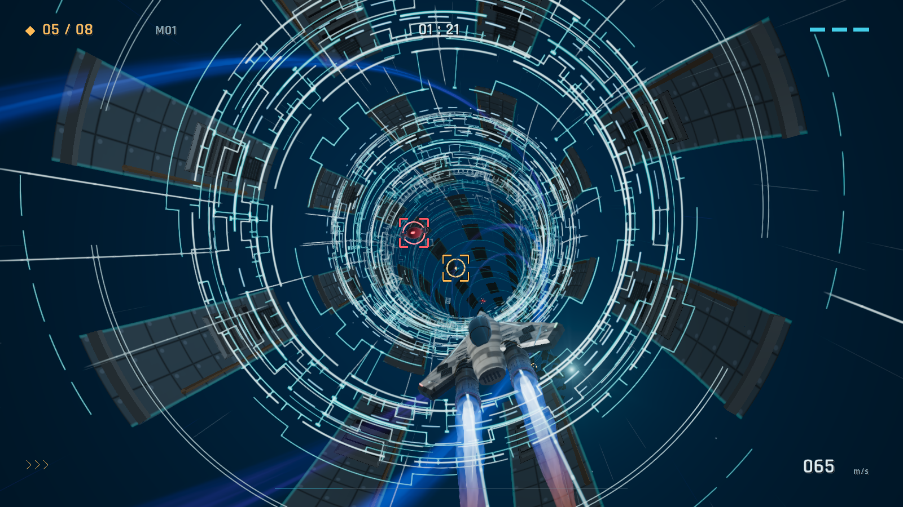
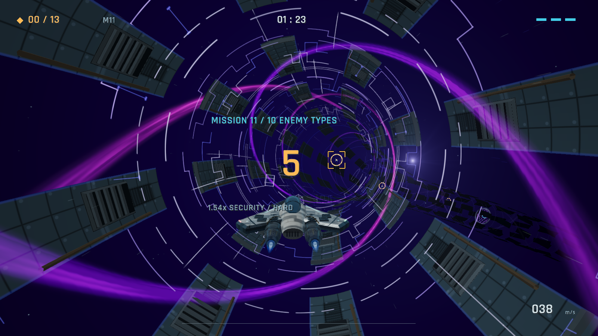

# DATA // RUN

A playable endless data-courier game built on the original `rec_tunnel` C11/raylib
flight sandbox. Fly through the twisting Data Vortex tunnel, collect amber data
gates, avoid security hazards and enter the cyan uplink before time runs out.
The tunnel is the default route; Grid City is selectable from the menu.



## Play

Collect at least **8 of 25 data gates** on a 3,000 metre route within **90 seconds**.
Those are the opening mission's rules. Each successful uplink triggers a
**2.4-second super-warp**, then a **five-second countdown** into a new procedural
route with a new tunnel palette and techno arrangement. Your score carries
forward and one shield point recovers. There is no final mission.

Three hazard hits disable the ship. Consecutive pickups increase your score
multiplier, and near misses earn bonuses. Hold boost to accelerate from
**32 to 65 m/s**; missed pickups do not interrupt boost.

| Key | Action |
| --- | --- |
| Enter | Start / retry |
| WASD / arrows | Steer |
| Shift / Space | Boost / afterburner |
| Q / E | Barrel roll |
| Escape | Pause / resume |
| R | Restart |
| Backspace | Return to menu |
| 1 / 2 in menu | Tunnel / Grid City |
| M | Mute / unmute |
| F11 | Fullscreen |
| F12 | Screenshot |

The game pauses when its window loses focus, including during warp and countdown.
Restart begins a fresh run at mission one; progression is not saved between runs.

| Mission | New enemy types | Total kinds |
| --- | --- | --- |
| 1 | Guard drone, moving sweeper | 2 |
| 2 | Paired mines, laser wall | 4 |
| 3 | Orbiter, moving shutter | 6 |
| 4 | Interceptor, laser rotor | 8 |
| 5 | Pulsar, splitter | 10 |
| 6 onward | All ten kinds, increasing difficulty | 10 |

Later missions increase speed, gate and hazard density, and enemy motion;
openings and pickup tolerance tighten, payload requirements rise, and deadlines
shorten. Amber data, red hazards and cyan safe openings keep their colors.
The difficulty multiplier grows from **1.40× at mission 10** to **2.80× at 20**
and **2.98× at 21**. Mission 11 introduces compound attack waves; from 21 they
occur twice as often and damage immunity shortens. Speed and opening sizes
approach playable limits smoothly. The countdown shows the current multiplier.



## Features

- The original curved tunnel, rotating rings and helical ribbons, with smoother
  curves, detailed wall panels and faint peripheral speed streaks. Fine scenery
  fades between 45 and 125 metres; sparse smooth rings preserve distant depth
  without filling the flight lane with overlapping line detail.
  Solid wall ribs, framed vent banks and coupled conduits add **209,664 bytes**
  of generated hardware geometry per streamed 48 metre section. Hardware detail
  fades with distance and stays outside the flight lane.
- A smooth courier ship with painted-metal texture, material lighting,
  raised service hatches, fasteners, cooling louvers, machined engine collars,
  articulated exhaust hardware and layered blue/orange afterburner flames.
  The latest pass adds cooling fins, tubular canopy frames and engine plumbing:
  **203,952 additional bytes** of vertex/index data, beyond the previous pass.
- Ten enemy types with distinct motion and collision shapes, introduced two
  per mission. Clear target brackets and a minimal flight HUD.
- Original stereo techno synthesized live at 48 kHz, rising from **140 to
  166 BPM** with actual speed, five mission arrangements with different bass
  progressions and percussion, and a faster warp mix. Procedural sound effects.
- Sustained boost and full elapsed-time simulation across long frames.
- A startup crash fix for zero-time first frames. Windows builds embed their
  textures, shaders, presets, font and license notices, so the EXE runs alone.

## Build

Requires CMake 3.20+ and a C11 compiler. CMake fetches pinned raylib 5.5 and
raygui 4.0. OpenGL 3.3 and an audio device are used by the game. On Windows,
MinGW builds statically link the compiler runtime and embed game resources.

From the repository root:

```sh
cmake -S sandbox/cybertunnel -B build -DCMAKE_BUILD_TYPE=Release -DCMAKE_POLICY_VERSION_MINIMUM=3.5
cmake --build build --parallel
ctest --test-dir build --output-on-failure
cmake --install build --prefix package --component Runtime
```

Launch `build/cybertunnel.exe` on Windows, or `build/cybertunnel` on Linux.
The installed package contains the executable and editable resource folders.
On Windows the executable also works without those folders. Linux builds keep
the `shaders`, `presets` and `assets` folders beside the executable.

## Verification and development

Seven Windows CTest suites cover core behavior, mission rules, procedural music,
ship geometry, six consecutive missions, normal startup and standalone EXE
startup. The engine checks
create hidden graphics windows and exercise the audio device while muted.
The four platform-independent suites do not require a graphics window.

```sh
build/cybertunnel --hidden --startup-check
build/cybertunnel --hidden --autoplay --missions 6 --audio-check --seed 83
build/cybertunnel --hidden --mission-shot 9 --w 1920 --h 1080 --out gameplay.png
build/cybertunnel --hidden --transition-shot 3.2 --out countdown.png --seed 83
build/cybertunnel --music-preview techno-preview.wav --mission 2 --seed 83
build/cybertunnel --sandbox --env 0
```

Use `cybertunnel.exe` in those commands on Windows. The music preview exports
24 seconds of the live synthesizer, moving from cruise to afterburner tempo.
`--missions N` bounds an automated test run; interactive play remains endless.
`--mission N` starts a particular mission for testing. `--transition-shot` captures
seconds after the first successful uplink. `--sandbox` retains the original
development environments and debug tools.

See [game details and verification](sandbox/cybertunnel/DATA_RUN.md) and the
[module integration guide](sandbox/cybertunnel/INTEGRATION.md).

## License

The original project is distributed under the [MIT License](LICENSE).
Third-party notices and the Rajdhani font's SIL Open Font License are included
in [assets](sandbox/cybertunnel/assets). The generated ship texture's native
resolution and production prompt are recorded with the asset.
